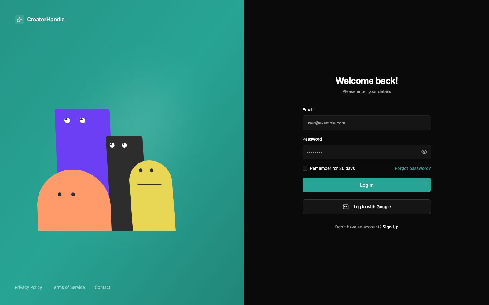
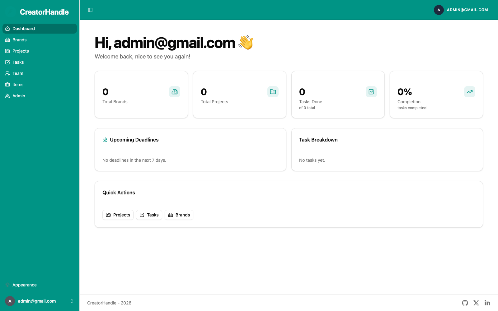
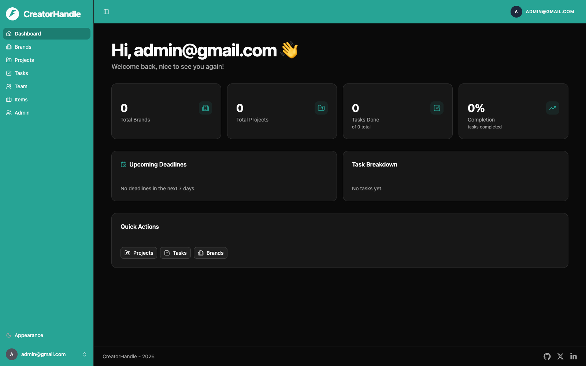
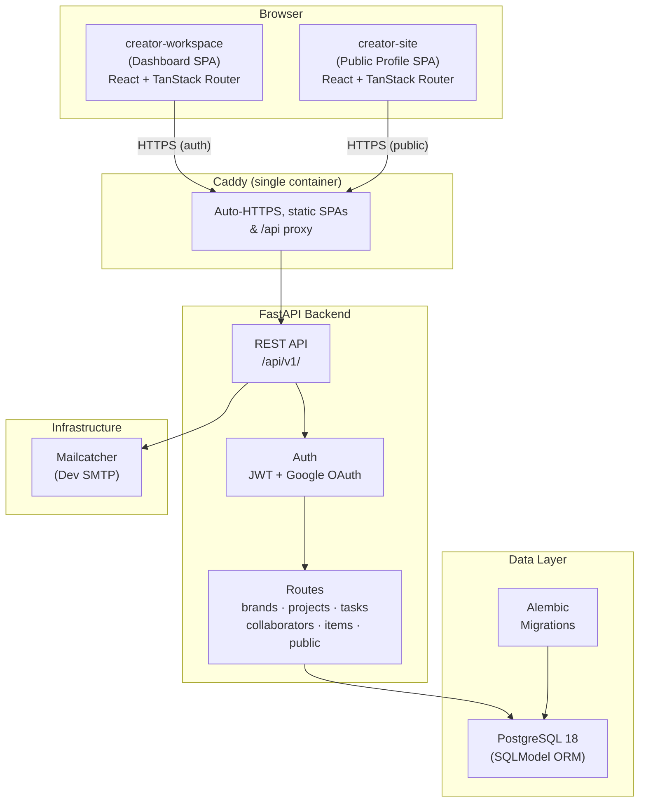
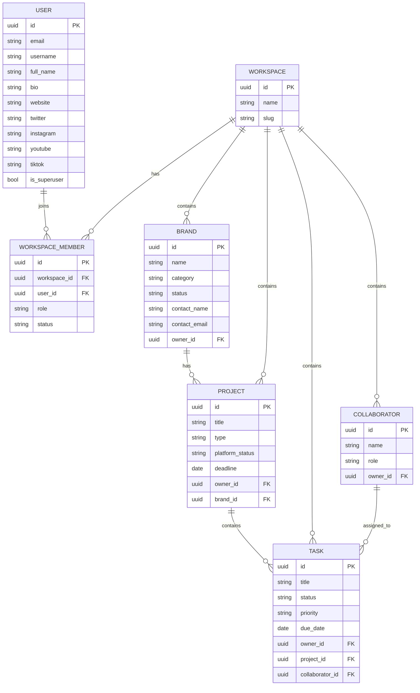
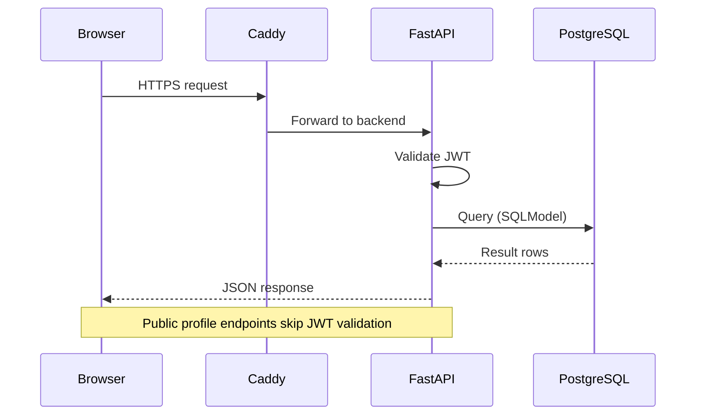

# CreatorHandle

A full-stack creator management platform. Creators get a **private workspace dashboard** to manage their brands, projects, tasks, and team — plus a **public profile page** that showcases their work to the world.

---

## Overview

CreatorHandle gives content creators and agencies a single hub to:

- Organize brands, projects, and tasks in one place
- Track project progress and deadlines
- Assign tasks to named collaborators (team members)
- Share a polished public profile page with potential clients

The platform is split into two frontends backed by a single FastAPI/PostgreSQL API:

| App | Purpose |
|---|---|
| **creator-workspace** | Private dashboard — auth-protected, full CRUD for all entities |
| **creator-site** | Public profile — no auth, displays creator's portfolio to visitors |

---

## Quick start

Needs Docker (Compose v2), [uv](https://docs.astral.sh/uv/) and [Bun](https://bun.sh/) 1.4.

```bash
make setup    # .env from .env.example, Python + JS deps, git hooks
# edit .env (at least SECRET_KEY, POSTGRES_PASSWORD, FIRST_SUPERUSER_PASSWORD, S3_SECRET_KEY)
make up       # http://localhost:5173 (site), /app/ (dashboard), :8000/docs (API)
```

| Command | What it does |
|---|---|
| `make up` / `make down` | Start / stop the dev stack (data volumes are kept) |
| `make dev` | Dev stack with backend live-sync |
| `make test` | Backend tests (in a separate `*_test` database) |
| `make test-e2e` | Playwright tests against the running stack |
| `make check` | Lint + type-check everything (ruff, mypy, Biome, tsc) |
| `make format` | Apply lint/format fixes |
| `make client` | Regenerate the frontend API clients from the backend |
| `make migration m="..."` / `make migrate` | Create / apply a database migration |
| `make build` | Build production images |

`make help` lists everything. Deployment: [docs/deployment.md](docs/deployment.md).

## Folder guide

| Path | Purpose |
|---|---|
| `backend/` | FastAPI service: `app/api` (routes), `app/core` (config, db, security, logging, storage), `app/domain` (business rules), `app/models` + `app/crud` (per domain), `app/emails`, `app/cli`, `tests/` |
| `frontend/creator-workspace/` | Dashboard SPA, served at `/app` |
| `frontend/creator-site/` | Marketing page + public profiles at `/` and `/@username` |
| `frontend/packages/shared/` | Constants and helpers both SPAs use |
| `frontend/Caddyfile`, `frontend/Dockerfile` | One Caddy image serving both SPAs and proxying `/api` and `/media` |
| `scripts/` | API client generation, test runners |
| `compose*.yml` | Docker Compose: base, dev override (auto-applied), production |
| `docs/` | Architecture, development, deployment, Docker and theme guides |
| `.github/workflows/ci.yml` | CI: lint → type-check → test → build |

---

## Screenshots

| Login | Dashboard (light) | Dashboard (dark) |
|---|---|---|
|  |  |  |

---

## Architecture



### Data Model



### Request Flow



---

## Tech Stack

### Backend

| Layer | Technology |
|---|---|
| Framework | [FastAPI](https://fastapi.tiangolo.com/) 0.114+ |
| Language | Python 3.12 |
| ORM | [SQLModel](https://sqlmodel.tiangolo.com/) + SQLAlchemy |
| Database | PostgreSQL 18 |
| Migrations | Alembic |
| Auth | PyJWT · pwdlib (bcrypt/argon2) · Google OAuth 2.0 |
| Validation | Pydantic v2 |
| Email | Jinja2 templates + SMTP |
| Package manager | [uv](https://docs.astral.sh/uv/) |

### Frontend (both apps)

| Layer | Technology |
|---|---|
| Framework | React 19 + TypeScript |
| Router | [TanStack Router](https://tanstack.com/router) v1 (file-based) |
| Server state | [TanStack Query](https://tanstack.com/query) v5 |
| Forms | React Hook Form 7 + Zod |
| UI components | [shadcn/ui](https://ui.shadcn.com/) + Radix UI primitives |
| Styling | Tailwind CSS v4 |
| HTTP client | Axios (auto-generated OpenAPI client) |
| Build tool | Vite 7 + SWC |
| Package manager | [Bun](https://bun.sh/) |
| Linting | Biome |
| Shared code | `@creatorhandle/shared` workspace package |

### Infrastructure

| Service | Technology |
|---|---|
| Containerization | Docker + Docker Compose |
| Web server / proxy | [Caddy](https://caddyserver.com/) (auto-HTTPS, static SPAs, `/api` proxy) |
| Dev email | Mailcatcher |
| Error tracking | Sentry SDK |
| Logging / health | JSON request logs with request ids; `/api/v1/utils/ready/` readiness check |
| CI | GitHub Actions (ruff, mypy, pytest, Biome, tsc, builds, client drift) |

---


## Documentation

- [Architecture & reference](docs/README.md)
- [Local Development Guide](docs/development.md)
- [Deployment Guide](docs/deployment.md)
- [Docker setup](docs/docker.md)
- [Portfolio themes](docs/portfolio-themes.md)
- [Backend Guide](backend/README.md)
- [Frontend Guide](frontend/README.md)
- [Security Policy](docs/SECURITY.md)

---

## License

MIT
